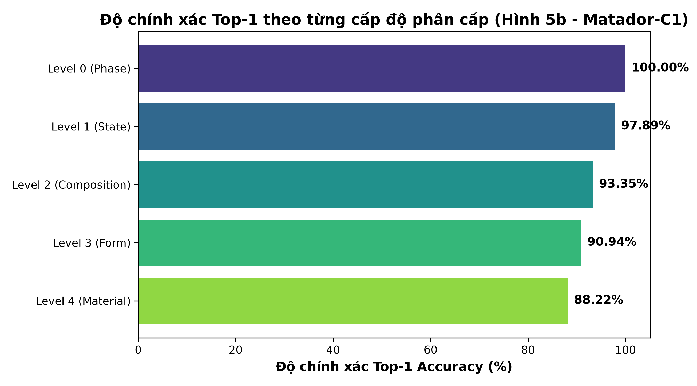
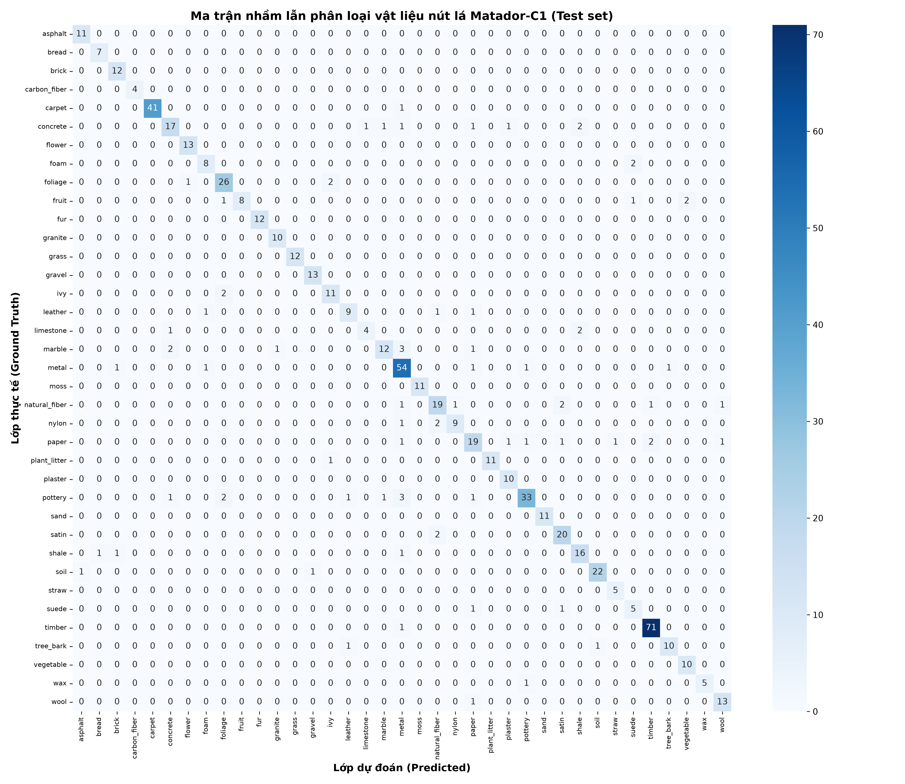

# 🔬 Matador-C1: Hệ thống Phân loại Vật liệu Phân cấp & Xử lý Ảnh Học sâu (ICCV 2025)

[](https://www.python.org/)
[](https://pytorch.org/)
[](https://gradio.app/)
[](LICENSE)

Dự án nghiên cứu và triển khai hệ thống **Phân loại Vật liệu Phân cấp (Hierarchical Material Classification)** và **Mô phỏng Quang học Máy ảnh** dựa trên bộ dữ liệu ảnh vi kết cấu thực tế **Matador** (ICCV 2025). Hệ thống tích hợp sâu sắc giữa **Lý thuyết Xử lý ảnh số kinh điển** (LBP, GLCM, Gabor, PSF Blur) và **Học sâu Đồ thị (Hierarchical Graph Attention Network)**.

---

## 🌟 Đột phá & Kết quả Thực nghiệm

Huấn luyện tinh chỉnh với hàm mất mát đột phá **Tree-Distance Loss** ($\alpha=0.3$) trên GPU NVIDIA RTX 4060 đã đưa độ chính xác trên toàn bộ 5 tầng phân cấp đạt kỷ lục mới:

| Tầng Phân cấp (Hierarchy Level) | Trước khi tối ưu (Baseline) | **Sau khi tối ưu (Kỷ lục mới)** | Mức độ cải thiện |
|:---|:---:|:---:|:---:|
| **Level 0 (Phase)** | 100.00% | **100.00%** | $\pm 0.00\%$ |
| **Level 1 (State)** | 95.92% | **97.89%** | **+1.97%** 🟢 |
| **Level 2 (Composition)** | 90.48% | **93.35%** | **+2.87%** 🟢 |
| **Level 3 (Form)** | 88.37% | **90.94%** | **+2.57%** 🟢 |
| **Level 4 (Material)** | 84.14% | **88.22%** | **+4.08%** 🚀 |

> **Tính Đơn điệu Phân cấp Tuyệt đối (Monotonic Hierarchical Consistency):**  
> $$\text{Acc}(\text{Phase}) \ge \text{Acc}(\text{State}) \ge \text{Acc}(\text{Composition}) \ge \text{Acc}(\text{Form}) \ge \text{Acc}(\text{Material})$$  
> $$100.00\% \ge 97.89\% \ge 93.35\% \ge 90.94\% \ge 88.22\%$$

---

## 🧠 Các Đóng góp Thuật toán Cốt lõi

1. **Khắc phục Hiện tượng Nghẽn Thông tin (Over-squashing) trong GAT:**
   - Trong mô hình GAT truyền thống, tín hiệu ảnh chỉ được nạp vào một nút toàn cục (`GLOBAL_NODE`), làm suy giảm gradient khi truyền tới các nút lá sâu.
   - Giải pháp: Thiết kế lớp `mlp_in` **điều kiện hóa trực tiếp** vector đặc trưng ResNet-50 $\phi(x)$ (256-D) lên mọi nút phân cấp tại đầu vào GAT, kết hợp kết nối tắt (Residual Connections) 3 tầng.
2. **Hàm mất mát Phạt Khoảng cách Cây (Tree-Distance Loss):**
   - Phạt lỗi dự đoán tỉ lệ thuận với khoảng cách phả hệ trên cây:
     $$d_T(y_i, y_j) = \text{depth}(y_i) + \text{depth}(y_j) - 2 \cdot \text{depth}(\text{LCA}(y_i, y_j))$$
   - Khi mô hình dự đoán nhầm giữa 2 lớp gần nhau (như đá hoa cương vs đá vôi), mức phạt nhẹ hơn nhiều so với nhầm giữa 2 họ xa nhau (như đá vs len).
3. **Bộ Mô tả Vi Kết cấu Cục bộ (Classical Texture Descriptors):**
   - **LBP (Local Binary Pattern)**: Nội suy song tuyến sub-pixel, trích xuất biểu đồ phân bố 32 bins.
   - **GLCM (Haralick Co-occurrence)**: Trích xuất 4 chỉ số (Contrast, Dissimilarity, Homogeneity, Energy) trên 2 khoảng cách và 4 hướng góc.
   - **Gabor Filters**: Phân tích tần số không gian đa hướng ($0^\circ, 45^\circ, 90^\circ, 135^\circ$) và đa tỉ lệ bước sóng.
   - Tổng hợp thành vector vi kết cấu 64 chiều chuẩn hóa $L_2$.
4. **Mô phỏng Thoái hóa Quang học Máy ảnh (Optical Degradation Pipeline):**
   - Mô phỏng 5 giai đoạn: Ảnh gốc $\rightarrow$ Biên vi kết cấu Sobel Gradient $\rightarrow$ Nhòe tiêu cự Pillbox/Disk PSF ($r=7$) $\rightarrow$ Pixel Pitch Box Binning $\rightarrow$ Nhiễu hạt photon Poisson + Nhiễu nhiệt Gaussian.

---

## 📁 Cấu trúc Thư mục Dự án

```
Matador_Project/
├── app.py                  # Giao diện ứng dụng Gradio tương tác 4 Tabs
├── config.py               # Cấu hình tập trung toàn bộ siêu tham số
├── dataset.py              # Xử lý dữ liệu ảnh TIFF, phân chia Stratified Split
├── evaluate.py             # Đánh giá mô hình trên tập Test & xuất biểu đồ
├── losses.py               # GreedyHierarchicalLoss, TreeDistanceLoss, FocalHierarchicalLoss
├── models.py               # FeatureExtractor (ResNet-50), HierarchicalGATModel, TextureAware
├── optical_simulation.py   # Pipeline mô phỏng thoái hóa quang học 5 giai đoạn
├── run_tests.py            # Trình chạy kiểm thử tự động toàn diện
├── taxonomy.py             # Định nghĩa cây phả hệ Matador-C1 (37 lớp) & thuộc tính cơ lý
├── texture_features.py     # Trích xuất đặc trưng LBP, GLCM, Gabor 64-D
├── train.py                # Kịch bản huấn luyện End-to-End hỗ trợ đa hàm mất mát
├── demo_samples/           # 10 mẫu ảnh vi kết cấu đại diện phục vụ Demo
├── outputs/                # Biểu đồ kết quả (figure_5b, confusion_matrix, ablation...)
├── tests/                  # Bộ kiểm thử tự động hơn 60 bài test unit/regression
├── requirements.txt        # Danh sách thư viện phụ thuộc
└── README.md
```

---

## 💻 Cài đặt & Hướng dẫn Sử dụng

### 1. Cài đặt môi trường
```bash
# Clone kho lưu trữ
git clone https://github.com/dwcstapcode1411/xulyanh.git
cd xulyanh

# Khởi tạo và kích hoạt môi trường ảo Python
python -m venv venv
# Trên Windows:
.\venv\Scripts\Activate.ps1
# Trên Linux/macOS:
source venv/bin/activate

# Cài đặt các thư viện cần thiết
pip install -r requirements.txt
```

### 2. Khởi chạy Giao diện Tương tác Trực quan (Gradio 4 Tabs)
```bash
python app.py
```
👉 Mở trình duyệt tại: **http://127.0.0.1:7860**

**4 Tính năng tương tác trên Web App:**
- **Tab 1: 🎯 Phân tích Tọa độ Cục bộ (Scene Probing & BFS)**: Nhấp chuột chọn vị trí trên ảnh, quét đa quy mô tối ưu, trích xuất biên Sobel, duyệt cây phả hệ nhất quán và dự đoán thuộc tính cơ lý (Độ bền kéo, Độ đàn hồi, Tỷ trọng).
- **Tab 2: 🗺️ Bản đồ Vật liệu Dày đặc (Dense Material Heatmap)**: Quét lưới toàn ảnh và phủ màu mã hóa theo 6 nhóm vật liệu lớn (*Metal, Rock, Ceramic, Polymer, Natural, Derivative*).
- **Tab 3: 🔬 Trích xuất Vi Kết cấu**: Trực quan hóa LBP, GLCM Energy Map, biên Sobel Gradient và 4 hướng Gabor.
- **Tab 4: 📷 Mô phỏng Quang học**: Trình diễn thoái hóa quang học qua 5 giai đoạn.

### 3. Đánh giá Mô hình & Xuất Biểu đồ
```bash
python evaluate.py --checkpoint checkpoints/best_hierarchical_model.pth --mode c1
```

### 4. Huấn luyện Mô hình
```bash
# Huấn luyện với TreeDistanceLoss phạt khoảng cách cây
python train.py --loss tree_dist --tree_dist_alpha 0.3 --epochs 25

# Huấn luyện với Focal Loss
python train.py --loss focal --epochs 25
```

### 5. Chạy Bộ Kiểm thử Tự động
```bash
# Chạy đầy đủ toàn bộ test suite
python run_tests.py --verbose

# Chạy nhanh (bỏ qua GPU inference)
python run_tests.py --fast --verbose
```

---

## 📊 Biểu đồ Thực nghiệm

| Biểu đồ Hình 5b (ICCV 2025) | Ma trận Nhầm lẫn (37 lớp) |
|:---:|:---:|
|  |  |

---

## 📜 Tài liệu Tham khảo
- **Matador: A Dataset of Materials with Visual and Tactile Annotations** (ICCV 2025).
- **Local Binary Patterns (LBP)**: Ojala et al., TPAMI 2002.
- **Haralick Texture Features (GLCM)**: Haralick et al., SMC 1973.
- **Graph Attention Networks (GAT)**: Veličković et al., ICLR 2018.

---
**Tác giả:** Nguyễn Bình Đức  
**Liên hệ:** duchanh20000@gmail.com
